  

  
  
  

## ✦ Flagship

<table>
  <tr>
    <td width="52%">
      
    </td>
    <td>
      <h3><a href="https://github.com/antonio-orionus/Arroxy">Arroxy</a></h3>
      A free, open-source video downloader for Windows, macOS and Linux, built on yt-dlp.
        
      ▸ YouTube + 2000 other sites 
      ▸ 4K, 1080p60, HDR, playlists, channels, subtitles 
      ▸ No ads, no tracking, no login 
      ▸ 30 languages
        
      
      
    </td>
  </tr>
</table>

## ✦ The yt-dlp toolkit

Pieces I pulled out of Arroxy and published on their own:

| Package | npm | What it does |
|---|---|---|
| [**yt&#8209;dlp&#8209;bridge**](https://www.npmjs.com/package/yt-dlp-bridge) |  | TypeScript toolkit for safe yt-dlp command planning, argv generation, execution, parsing and structured errors. |
| [**ytdlp&#8209;errors**](https://github.com/antonio-orionus/yt-dlp-errors) |  | Turns yt-dlp stderr into a closed set of error kinds (`botBlock`, `rateLimit`, `geoBlocked`, `drmProtected`, …). Zero deps, snapshot-tested against upstream. |
| [**yt&#8209;dlp&#8209;mcp&#8209;server**](https://github.com/antonio-orionus/yt-dlp-mcp-server) |  | MCP server that gives AI agents typed tools to inspect, plan, download and post-process media. |

## ✦ Also in orbit

- [**url-sanitize**](https://github.com/antonio-orionus/url-sanitize): strips tracking parameters and unwraps tracking redirects. A ClearURLs-compatible library and CLI for JS, Rust, Python and CI.
- [**anki-macos-native**](https://github.com/antonio-orionus/anki-macos-native): makes Anki look like a native macOS 27 app, with a unified toolbar, Liquid Glass controls and inset grouped lists.
- [**skills**](https://github.com/antonio-orionus/skills): agent skills for Claude Code, Codex, Cursor, Copilot and 20+ other coding agents.
- [**awesome-video-downloaders**](https://github.com/antonio-orionus/awesome-video-downloaders): a curated list of apps for downloading video and audio.

## ✦ Usual tools

  
  
  
  
  
  
  
  
  
  

<picture>
  <source media="(prefers-color-scheme: dark)" srcset="https://raw.githubusercontent.com/antonio-orionus/antonio-orionus/output/snake-dark.svg">
  <source media="(prefers-color-scheme: light)" srcset="https://raw.githubusercontent.com/antonio-orionus/antonio-orionus/output/snake.svg">
  
</picture>
